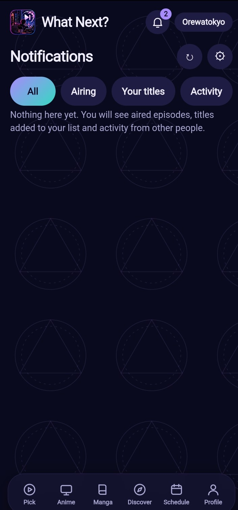
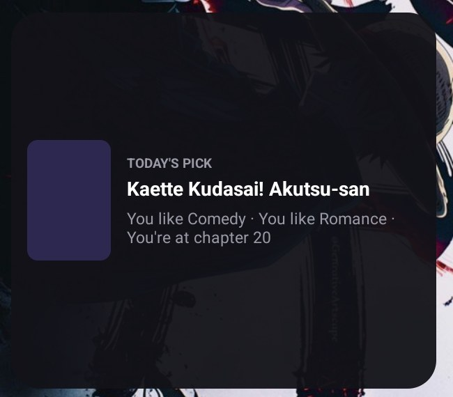
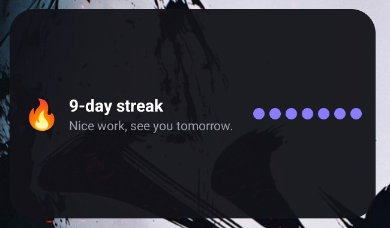

<p align="center">
  
</p>

<h1 align="center">What Next?</h1>

<p align="center">
  <b>Tell it how much time you have. It picks your next anime or manga from your AniList.</b><br>
  An Android app · Version 3.0.0
</p>

<p align="center">
  <a href="https://github.com/tokyo720022-create/What-Next/actions/workflows/build-apk.yml"></a>
  <a href="https://github.com/tokyo720022-create/What-Next/actions/workflows/tests.yml"></a>
  <a href="https://github.com/tokyo720022-create/What-Next/releases/latest"></a>
</p>

## Screenshots

<table>
  <tr>
    <td rowspan="2" valign="top"><br><sub>Notifications</sub></td>
    <td valign="top"><br><sub>Today's pick widget</sub></td>
  </tr>
  <tr>
    <td valign="top"><br><sub>Daily streak widget</sub></td>
  </tr>
</table>

## What it does

- **Pick** – choose how much time you have and get one title from what you are watching, rewatching or plan to read. *Surprise me*, *Build a lineup* and *Something new for my taste* are there too. **Pick Memory** learns from *Great pick*, *Not for me* and *Not today* (you can see why each title was picked, pause it or reset it).
- **Anime and Manga lists** – your full AniList lists with filters, sorting, +1 progress, scores, notes, dates and custom lists. Changes are queued and sent later when you are offline.
- **Discover and Seasonal** – trending, search and this season's titles, with a **relation map** and a **watch/read order** that tells you where to start or continue a franchise.
- **Schedule** – when your anime air, in your own time zone.
- **Notifications** – release reminders 3 hours and 30 minutes before an episode and when it airs, your AniList notifications (aired episodes, sequels added, likes) and alerts when a title on your list changes.
- **Home screen widgets** – *Airing soon*, *Continue Watching* (with a tick to mark the next episode), *Updates*, *Daily streak* and *Today's pick*.
- **Taste report** – your archetype, personality type and vibe, what your list says about how you rate and finish, and a picture of it you can share, copy or save.
- **Profile and stats** – your AniList profile, statistics and favourites.
- **AniList Triple Sync** (advanced) – copy a list to a second AniList account and to MyAnimeList, with optional Discord cards. Its keys are encrypted on the phone and the page can be locked with a PIN or your fingerprint.

## Install

1. Open the [latest release](https://github.com/tokyo720022-create/What-Next/releases/latest) on your phone and download the APK.
2. Install it (allow installs from your browser if Android asks) and tap **Log in with AniList**.
3. Every new build installs over the old one and keeps your data.

> The release text ends with *Native add-ons … yes*. Widgets, background alerts, picture sharing and the lock need **yes**. If it says *secure* or *no*, that build fell back without them.

## Build it yourself

1. **AniList client (once):** create one at [anilist.co/settings/developer](https://anilist.co/settings/developer) with the redirect URL `whatnext://auth` and put its Client ID in `config.js` (`clientApp`). Client IDs are public.
2. **Signing key (once):** add the repository secrets `ANDROID_KEYSTORE_BASE64` and `ANDROID_KEYSTORE_PASSWORD` (*Settings > Secrets and variables > Actions*). `bash android-signing/generate-key.sh` makes a new key. The key is never kept in the repo.
3. **Push the files.** The *Build APK* workflow runs the tests first, then builds the app and publishes a new release with the APK. From a phone, upload a single `site.zip` to the repo root: the *Unpack site.zip* workflow unzips it and starts the build.
4. A few files cannot be changed through `site.zip` (the workflows, `package.json`, `capacitor.config.json`, `build-apk.yml`). Change those by hand in GitHub.

## Builds and releases

Each build makes its own release (tag `v<version>-b<number>`). Every APK is signed with the same key and has a version code that only goes up, so Android always accepts it as an update. If the build with the Kotlin add-ons fails, the workflow builds again with fewer of them rather than losing the build. More in [docs/DETAILS.md](docs/DETAILS.md#builds-and-releases).

## Privacy and security

- No server and no analytics. Your lists, settings, taste data and widget snapshot stay on your phone and talk only to AniList (and MyAnimeList or Discord if you use Triple Sync).
- Your AniList login is kept in the phone's encrypted store. Triple Sync keys, client secrets and Discord links are encrypted there too and are never shown again in full.
- Logging out removes your data from the phone. Details in [PRIVACY.md](PRIVACY.md).
- Unofficial app, not affiliated with AniList. 18+ content is whatever AniList lists as adult and follows your AniList settings.

## For developers

Plain HTML, CSS and JavaScript in an Android shell ([Capacitor](https://capacitorjs.com)), with a small Kotlin add-on for the native parts (`native/`). It uses the [AniList GraphQL API](https://docs.anilist.co/) and stays under its request limit.

```
index.html, boot.js   the shell that loads everything
js/core, js/features  the app code (one folder per kind of work)
views/, css/          screens and styles
native/               Kotlin add-on, widgets and the script that adds them to the build
tests/                unit tests, structure check and browser tests
docs/                 screenshots and the full details
```

Run the checks:

```
node tests/check-structure.js
for t in tests/unit/*.test.js; do node "$t" || break; done
python tests/e2e/run_all.py     # real-browser tests (pip install playwright && playwright install chromium)
```

Every feature, rule and number is explained in [docs/DETAILS.md](docs/DETAILS.md); the native add-on is described in [native/README.md](native/README.md).

## Credits

Company: Tokyo Brotherhood · Creator: Hariharasuthan Karunakaran · Contributor: Claude (AI) · See [LICENSE](LICENSE).
